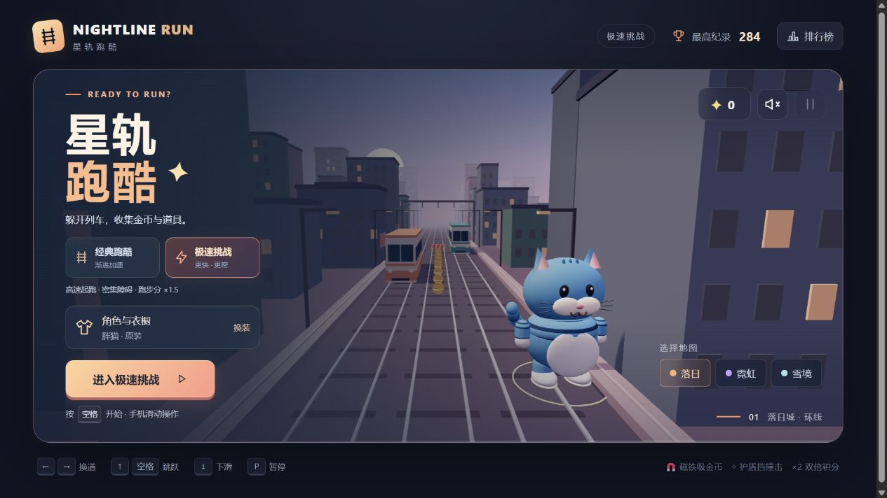

# 星轨跑酷 · NIGHTLINE RUN

[点击在线游玩](https://xinggui-run-qg.pages.dev/)

一款用键盘或手机滑动操作的三条跑道小游戏。包含奶龙、蓝色胖猫和猪猪侠三种卡通角色，每个角色可单独 DIY 衣服；可切换落日城市、霓虹夜城和雪境森林地图。



## 玩法

- 左右换道躲开列车，跳过路障，下滑穿过横杆。
- 在起点选择经典跑酷或极速挑战。极速模式高速起跑、加速更快、障碍更密，跑步积分为 1.5 倍，排行榜分别记录。
- 收集金币、磁铁、护盾和双倍积分道具。
- 每局提供两次免费复活，达到分数目标还会获得道具、星冠和额外复活。
- 排行榜、穿搭和解锁状态保存在当前浏览器中，记录得分最高的十局。

电脑使用方向键或 WASD，空格跳跃，P / Esc 暂停。手机可以滑动操作，也可以点击画面按钮。完整说明见 [游戏说明](docs/游戏说明.md)。

## 本地运行

安装 Node.js 后，在仓库目录运行：

```sh
npm start
```

然后打开终端提示的 `http://127.0.0.1:4173/`。项目没有需要安装的 npm 依赖。

也可以直接下载 [离线游戏文件](offline/星轨跑酷.html)，用 Chrome 或 Edge 打开，无需联网。

## 修改与检查

`dist/` 保存可直接运行的 HTML、CSS、游戏逻辑和角色模型。修改这些文件后运行：

```sh
npm test
npm run build
```

现有的 25 项玩法检查覆盖碰撞、换道、跳跃、下滑、道具、分数奖励、复活和极速模式；还会检查 1500 组障碍布局是否留有可通行跑道。另有 6 项排行榜检查，验证旧成绩兼容和两种模式分别保存。

构建会更新 `offline/星轨跑酷.html`，并生成 `site/` 网站上传目录。`site/` 包含全部画面、逻辑和音效，无需外部资源。

## 发布到 Cloudflare

当前公开网站使用 Cloudflare Pages 项目 `xinggui-run-qg`。

更新后，运行 `npm run build`，在 Cloudflare 中打开该项目，创建新的生产部署并上传 `site/` 文件夹，继续使用同一个公开网址。

GitHub 保存源码和版本记录；Cloudflare 提供在线游戏。提交源码后需要重新部署，网站才会更新。

## 目录

```text
dist/       游戏源码与 Three.js 运行库
scripts/    本地预览和离线构建
tests/      玩法检查
offline/    可以直接打开的单文件游戏
docs/       玩法说明和截图
site/       构建生成的 Cloudflare 上传目录（不入库）
```

Three.js 0.160.1 使用 MIT 许可，许可证保留在 `dist/vendor/THREE-LICENSE.txt`。角色参考用户指定的卡通形象制作。
